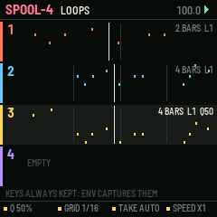
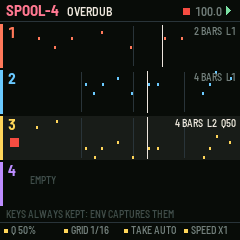
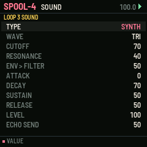
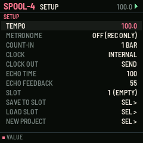

# SPOOL-4

Four loops you record by playing, for the M-VAVE FM-1. One of six sequencer firmwares built from a survey of sequencer archetypes (see the companion survey). Built on fm1-base; makes its own sound and sends MIDI.

## What it is for

**Archetype:** Live-loop recorder: loopers, OP-1 tape, MPC live record, retroactive MIDI capture.

SPOOL-4 is for players: you never enter a step, you play, and it keeps it. The first take sets a
loop's length to the nearest bar; each pass after it is an overdub layer that UNDO removes and REDO restores, so
experimenting costs nothing. Quantise is a dial applied as the loop plays, never written into the notes, so it can be
turned back at any time. And because the research found that the most-regretted moment is the good idea played when
nothing was recording, every note on the keys is kept: CAPTURE puts the phrase you just played into the loop.

## What it does

- 4 loops of up to 16 bars and 448 notes each, each with its own sound and MIDI channel.
- REC: first take (closes at the nearest bar, or a fixed length on K3), then overdubs; a bar's count-in from a stop.
- UNDO / REDO by layer; clear is undoable too.
- Non-destructive quantise: amount (K1) and grid (K2).
- FX held: erase what passes the playhead. ARP held + key: note repeat at the grid, recorded.
- Double or halve a loop; play it at half, normal or double speed (K4); transpose it (PRESETS).
- CAPTURE (ENV): the last phrase played on the keys, recorded or not, becomes a layer (an empty loop takes 1, 2, 4 or 8 bars).

## The controls

Hold any button alone for a second for its help card on the screen.

| Control | What it does |
| --- | --- |
| keys | play the loop's sound (always kept for capture; recorded while REC is lit) |
| ALGO | the loop |
| REC | first take / close it / overdub on and off |
| PLAY | start / stop |
| SEQ / SEL + SEQ | undo / redo a layer |
| EDIT / SEL + EDIT | mute / clear (redo brings it back) |
| ENV | capture |
| FX held | erase as it passes |
| ARP held + key | note repeat |
| LFO / SEL + LFO | double / halve |
| K1 K2 K3 K4 | quantise amount, grid, length of a new take, speed |
| PRESETS | transpose the loop |
| SELECT | tempo |
| OCT | the keys' octave |
| SEL tap / GLO / HOME | the loop's SOUND / SETUP (metronome, count-in, clock, slots) / LOOPS |

Common to all six: PLAY starts and stops, SAVE saves to the project slot, OCT- / OCT+ the octave.

## Screens

   

## Build, test, install

The firmware is built with [fm1-base](https://github.com/charlesvestal/fm1-base) (vendored in `base/`) and JieLi's
toolchain, which runs in Docker on macOS (`colima start` first). Python 3.11 with Pillow.

    ./build.sh --host              # the host simulator, then every test in app/tests/
    ./build.sh --shots             # the screenshots in app/docs/img/
    ./build.sh                     # a development package: app/build/spool-4.fwsc
    ./build.sh --release 0.1       # a release package: app/build/spool-4-0.1.fwsc

Install over USB with fm1-base's installer (the FM-1 connected, Python with `python-rtmidi`):

    python3.11 base/tools/fm1_install.py app/build/spool-4-0.1.fwsc

Keep M-VAVE's stock firmware and M-UPGRADE at hand: the installer can put the stock firmware back.

## Layout

| Path | What |
| --- | --- |
| `app/seq.c` | the sequencer: its data and the engine (runs inside the audio render, sample-exact) |
| `app/ui.c` | the controls and the screen |
| `app/app.c`, `app/app.h` | the contract with fm1-base |
| `app/core/` | shared with the five sibling firmwares: synth (8 voices, 11 drums, echo), transport and MIDI clock, project slots, controls kit, text |
| `app/tests/` | host-simulator scripts: `basic.txt` (behaviour) and `screens.txt` (pictures) |
| `app/fm1.toml` | build settings, package identity `FM-1_23`, firmware.json fields |
| `base/` | fm1-base and felucca-bsp, vendored (MPL-2.0) |

## Common to all six

- Its own sound: an 8-voice synth (saw, square, triangle, sine, noise, super-saw; resonant filter; ADSR; glide),
  eleven synthesised drums on General MIDI notes, and a shared echo. Every part also goes out as MIDI (its channel set
  on its sound page) over USB and Bluetooth MIDI.
- MIDI clock: INTERNAL (and send clock, start, stop) or FOLLOW an incoming clock. MIDI notes in play the part shown.
- Four project slots (SETUP / GLO page). SAVE while playing saves at the stop.
- Hold any button alone for a second: a help card explains it.

## Status

**0.1, untested on hardware.** It builds for the FM-1, passes its host-simulator tests, and its screens are taken
from the simulator. Nothing has been run on a real FM-1 yet; CPU load of the synth on the device is not measured.

## Licence

MPL-2.0, as fm1-base. After loopers, the OP-1's tape and the MPC's live record.
