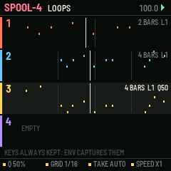
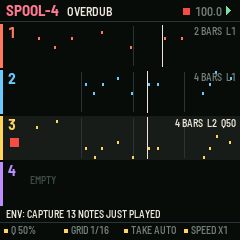
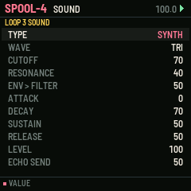
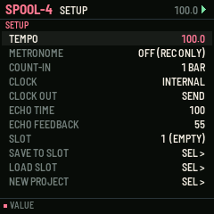

# SPOOL-4

Four loops you record by playing, for the M-VAVE FM-1. One of six sequencer firmwares built from a survey of sequencer archetypes (see the companion survey). Built on fm1-base; makes its own sound and sends MIDI.

## What it is for

**Archetype:** Live-loop recorder: loopers, OP-1 tape, MPC live record, retroactive MIDI capture.

SPOOL-4 is for players: you never enter a step, you play, and it keeps it. The first take sets a
loop's length to the nearest bar; each pass after it is an overdub layer that UNDO removes and REDO restores, so
experimenting costs nothing. Quantise is a dial applied as the loop plays, never written into the notes, so it can be
turned back at any time. And because the research found that the most-regretted moment is the good idea played when
nothing was recording, every note on the keys is kept: CAPTURE puts the phrase you just played into the loop.

## What it does

- 4 loops of up to 16 bars and 448 notes each, each with its own sound and MIDI channel.
- REC: first take (closes at the nearest bar, or a fixed length on K3), then overdubs; a bar's count-in from a stop.
- UNDO / REDO by layer; clear is undoable too.
- Non-destructive quantise: amount (K1) and grid (K2).
- FX held: erase what passes the playhead. ARP held + key: note repeat at the grid, recorded.
- Double or halve a loop; play it at half, normal or double speed (K4); transpose it (PRESETS).
- CAPTURE (ENV): the last phrase played on the keys, recorded or not, becomes a layer (an empty loop takes 1, 2, 4 or 8 bars).

## The controls

Hold any button alone for a second for its help card on the screen.

| Control | What it does |
| --- | --- |
| keys | play the loop's sound (always kept for capture; recorded while REC is lit) |
| ALGO | the loop |
| REC | first take / close it / overdub on and off |
| PLAY | start / stop |
| SEQ / SEL + SEQ | undo / redo a layer |
| EDIT / SEL + EDIT | mute / clear (redo brings it back) |
| ENV | capture |
| FX held | erase as it passes |
| ARP held + key | note repeat |
| LFO / SEL + LFO | double / halve |
| K1 K2 K3 K4 | quantise amount, grid, length of a new take, speed |
| PRESETS | transpose the loop |
| SELECT | tempo |
| OCT | the keys' octave |
| SEL tap / GLO / HOME | the loop's SOUND / SETUP (metronome, count-in, clock, slots) / LOOPS |

Common to all six: PLAY starts and stops, SAVE saves to the project slot, OCT- / OCT+ the octave.

## Screens

## Install

Use the [installer page](../install/) in Chrome or Edge with the FM-1 connected by USB. Keep M-VAVE's stock firmware
and M-UPGRADE at hand: the installer can put it back. To build it yourself, see the
[source](https://github.com/davidpryan/spool-4).

## Status

0.1, untested on hardware. It builds for the FM-1 and passes its host-simulator tests; nothing has been run on a real
FM-1 yet.
